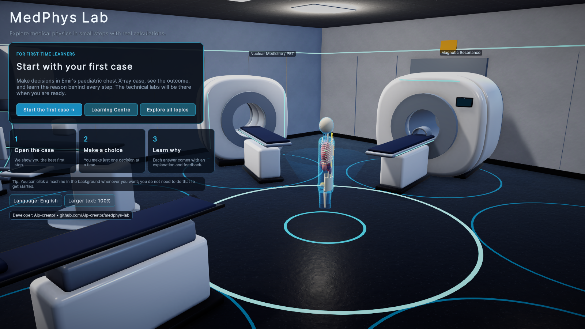
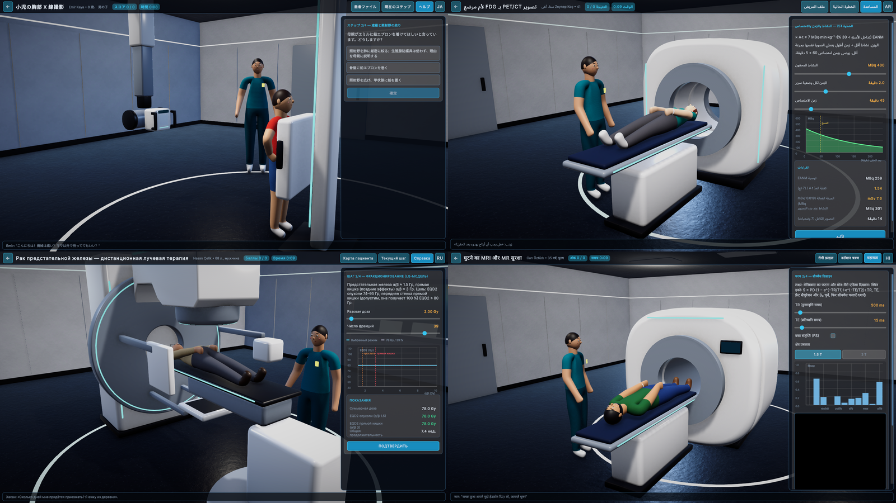
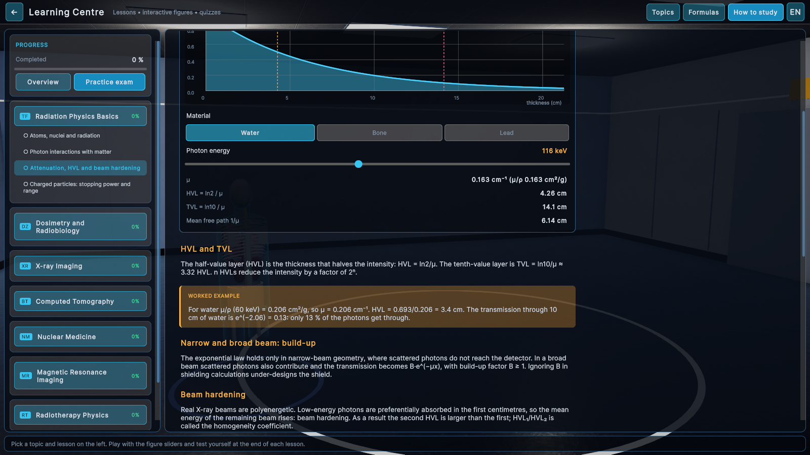
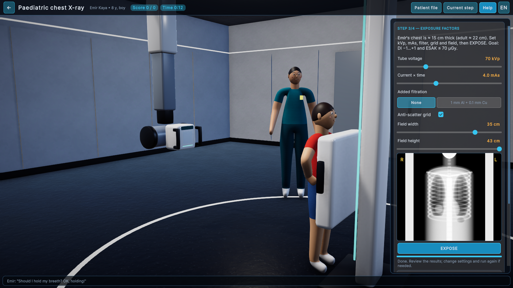
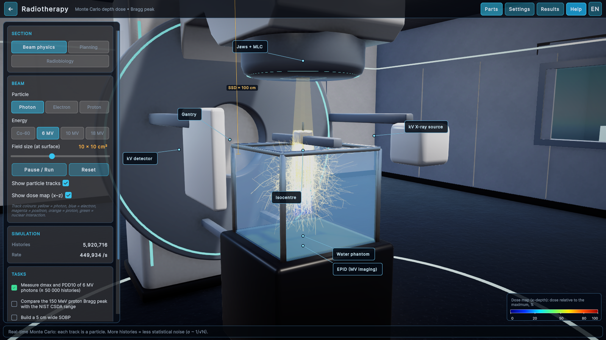

# MedPhys Lab — 3D Medical Physics Simulator

**Developed by / Geliştiren: [Alp-creator](https://github.com/Alp-creator)**

**EN:** Learn medical physics by playing with real physics: a learning centre with 36 lessons, a waiting room of
clinical cases and six interactive 3D labs (X-ray, CT, radiotherapy, nuclear medicine/PET, MRI, radiation protection),
all driven by physically based models and NIST reference data. Unity 6 (URP) — Windows and Android — 30 languages.

**TR:** Gerçek fizikle oynayarak medikal fizik öğren: 36 derslik öğrenme merkezi, klinik vakalarla dolu bir bekleme
salonu ve altı etkileşimli 3B laboratuvar (röntgen, BT, radyoterapi, nükleer tıp/PET, MR, radyasyondan korunma).
Hepsi fiziksel modellere ve NIST referans verilerine dayanır. Unity 6 (URP) — Windows ve Android — 30 dil.



> Educational software — not for clinical use. / Eğitim amaçlıdır — klinik kullanım için değildir.

## Download / İndir
Ready-to-run builds are on the [**Releases**](../../releases/latest) page:
- **Windows:** `MedPhysLab_Windows.zip` → extract → `MedPhysLab.exe`
- **Android:** `MedPhysLab.apk` → allow installing from unknown sources → install

**Controls:** mouse drag = orbit, right-drag = pan, wheel = zoom · touch: one finger = orbit, two fingers = zoom/pan ·
the *Theory* button shows formulas and explanations for every module.

## Languages / Diller
Türkçe · English · Deutsch · Français · Español · Português · Italiano · Nederlands · Polski · Čeština · Română ·
Magyar · Svenska · Dansk · Norsk · Suomi · Ελληνικά · Русский · Українська · Azərbaycanca · Bahasa Indonesia ·
Tiếng Việt · العربية · فارسی · हिन्दी · বাংলা · ไทย · 简体中文 · 日本語 · 한국어

The interface, labs, clinical cases and all 36 lessons of the Learning Centre are available in all 30 languages
(right-to-left layout for Arabic and Persian, complex-script shaping for Hindi, Bengali and Thai).
Translations other than Turkish and English are machine-assisted — corrections are welcome (see *Translations* below).



## Contents / İçerik

### Learning Centre / Öğrenme Merkezi
8 topics and 36 lessons, from the atom to radiotherapy: radiation physics, dosimetry & radiobiology, X-ray imaging,
CT, nuclear medicine & PET, MRI, radiotherapy and radiation protection. Every lesson has explanations, key formulas,
worked examples, interactive figures driven by the same physics engine (attenuation, μ/ρ, X-ray spectra, Compton,
inverse square, decay, the Tc-99m generator, PDD, the Bragg peak, LQ survival, MR relaxation, HU, SSDE, CT noise) and a
quiz with instant feedback; topic quizzes, a practice exam, a formula sheet and a glossary complete it.



### Clinical cases / Klinik vakalar — you are the hospital's medical physicist
Seven patients wait in the lobby. Read the file, make decisions, run the machine — the physics engine computes the
outcome — then get feedback, a score, a dose tally and a debrief with references.

| Patient | Topic | Physics behind it |
|---|---|---|
| Emir, 8 | Paediatric PA chest X-ray | Ray tracing through a scaled phantom, EI/DI (IEC 62494-1), ESAK vs DRL, grid / Cu filter |
| Can, 35 | Knee MRI and MR safety | Spin-echo signal equation, fat saturation, CNR, Larmor frequency, SAR ∝ B₀² |
| Mehmet, 52 | CT in a large patient | ROI noise in an FBP image, CTDIvol, SSDE (AAPM 204) |
| Elif, 29 | Possible pregnancy + appendicitis | Low-dose CT, fetal dose ≈ SSDE, ICRP 84 counselling |
| Zeynep, 41 | FDG PET in a breastfeeding mother | EANM activity (A·t ∝ kg), F-18 decay, infant dose by the inverse-square law |
| Ayşe, 74 | Cheek BCC, electrons | Electron PDD + bolus, R90/R50, EQD2 (α/β 10/3) |
| Hasan, 68 | Prostate EBRT | Photon PDD, LQ/EQD2 (α/β 1.5/3), hypofractionation, IGRT |



### Labs / Laboratuvarlar
| Lab | Physics |
|---|---|
| **X-ray** | Kramers bremsstrahlung + W characteristic lines, Al/Cu filtration, HVL and effective energy (NIST μ/ρ), polyenergetic ray tracing through an anthropomorphic phantom, CsI detector efficiency, quantum noise, scatter + grid, EI/DI, ESAK, DAP, effective dose |
| **CT** | Polyenergetic projections, Poisson noise, water beam-hardening correction, FFT ramp filters (Ram-Lak, Shepp-Logan, cosine, Hann), filtered back-projection, HU calibration, window/level, metal and few-view artefacts, CTDIvol/DLP/E |
| **Radiotherapy** | Condensed-history Monte Carlo (Klein–Nishina Compton, pair production, Bethe + Sternheimer electron stopping power, Highland multiple scattering, Bethe–Bloch protons, Bohr straggling, nuclear interactions), PDD/Bragg peak, SOBP, 2D treatment planning with EPL heterogeneity correction, DVH, QUANTEC constraints, LQ model, BED/EQD2, TCP |
| **Nuclear medicine** | Stochastic decay (10 radionuclides), effective half-life, Mo-99/Tc-99m generator (Bateman), PET: positron range, non-collinearity, attenuation, Compton scatter, randoms, NEC, FBP and MLEM reconstruction, partial-volume recovery |
| **MRI** | Bloch equations (isochromat ensemble), Larmor frequency, T1/T2/T2*, spin echo, SE/GRE/IR signal equations (T1W, T2W, PD, FLAIR, STIR), Ernst angle, k-space (2D FFT), aliasing, partial Fourier, motion artefact |
| **Radiation protection** | Γ·A/d² inverse-square law, lead/steel/concrete/water shielding (NIST μ + build-up), HVL/TVL, floor dose-rate map, Geiger clicks, source-retrieval mission, ICRP 103 limits |



### Validation (Monte Carlo vs reference)
| Quantity | Simulation | Reference |
|---|---|---|
| Proton CSDA range, 150 MeV | 15.77 cm | 15.77 cm (NIST PSTAR) |
| Electron CSDA range, 10 MeV | 4.93 cm | 4.98 cm (NIST ESTAR) |
| 6 MV PDD(10 cm), 10×10, SSD 100 | 65–66 % | 66.8 % (BJR-25) |
| 18 MV PDD(10 cm) | 78.4 % | 79 % |
| Co-60 PDD(10 cm), SSD 80 | 59.2 % | 58.7 % |
| 16 MeV electron R50 | 6.88 cm | 6.87 cm (E/2.33) |
| CT HU (120 kVp): water / fat / lung | ≈ 0 / −105 / −708 | 0 / −100 / −700…−850 |
| Tc-99m T½ (MC measurement) | 6.0 ± 0.3 h | 6.01 h |

Data sources: NIST XCOM photon coefficients (20 materials), NIST PSTAR/ESTAR ranges, ICRU 44 tissue compositions,
ICRP 103, BJR Suppl. 25 typical PDDs, literature T1/T2 values (e.g. Stanisz 2005).

## Building from source / Derleme
1. Install **Unity 6000.6.2f1** (with Windows Build Support; Android Build Support for the APK).
2. Open this folder in Unity Hub. The first import takes a few minutes.
3. Menu **MedPhys → Build Windows** / **Build Android APK** (outputs go to `Builds/`).

A Google Play bundle (`MedPhysBuild.BuildAndroidAppBundle`) reads its signing key from the environment variables
`MP_ANDROID_KEYSTORE`, `MP_ANDROID_KEYSTORE_PASS`, `MP_ANDROID_KEY_ALIAS` and `MP_ANDROID_KEY_PASS`; no signing
material is stored in the repository.

## Project layout
```
Assets/Scripts/Physics    physics engines (Nist, XRaySpectrum, Phantom, Radiography, CTSim, BeamMC, StoppingPower,
                          DepthDose, PlanDose, Radiobiology, Isotopes, PetSim, MriPhysics, Shielding, Fft)
Assets/Scripts/Modules    Hub, Learn, Cases, XRay, CT, Therapy, NucMed, MRI, Protection
Assets/Scripts/Cases      clinical case engine, case content, case simulations, patient characters
Assets/Scripts/Learn      curriculum loader and interactive lesson figures
Assets/Scripts/Core, UI   app, camera, environment, localisation (Loc.cs), UI Toolkit helpers, charts
Assets/Resources/Learn    lesson texts (line-based format, see Assets/Scripts/Learn/Curriculum.cs)
Assets/Resources/Lang     translation tables (one file per language)
Assets/Resources/Models   equipment and patient models (FBX) generated by Tools/Blender
Assets/Editor             setup and build scripts (MedPhys menu), tests
Bridge/                   editor bridge and command-line tools (screenshots, translation pipeline)
Tools/Blender/            parametric Blender scripts for every 3D model
```
Regenerate a model headlessly: `blender -b --factory-startup --python Tools/Blender/run_bg.py -- patient.py`.

## Translations
Every UI string is written in code as `T("Türkçe", "English")`. `Bridge/i18n_extract.py` collects the English texts
into `Assets/Resources/Lang/_keys.txt` (numbers are masked as `#`), and each language file maps a hash of that key to
its translation, so translations survive code changes. To fix or add a translation, write `N|text` lines
(N = line in `_keys.txt`) and merge them with `python Bridge/i18n.py merge <code> <file>`; the tool checks that
placeholders, tags and line breaks are kept. Lesson equations are language-neutral unless they contain words; then
they are written as `$ denklem || equation` and translated like any other line. Arabic and Persian always show the
English form of equations (`Loc.TEq`): inside a left-to-right formula, right-to-left words make the bidi algorithm move
numbers next to the wrong symbols. `python Bridge/i18n.py status` shows coverage. After changing
translations, run `python Bridge/i18n_fonts.py --subset` and **MedPhys → Fonts** so the fonts contain every character.
Pull requests that improve translations are very welcome.

## Author / Geliştirici
MedPhys Lab is designed and developed by **[Alp-creator](https://github.com/Alp-creator)**.
MedPhys Lab, **Alp-creator** tarafından tasarlanıp geliştirilmiştir.

## License
© 2026 Alp-creator. Code, content and models: [MIT](LICENSE). Fonts: SIL Open Font License 1.1 — see
[THIRD_PARTY_NOTICES.md](THIRD_PARTY_NOTICES.md).
